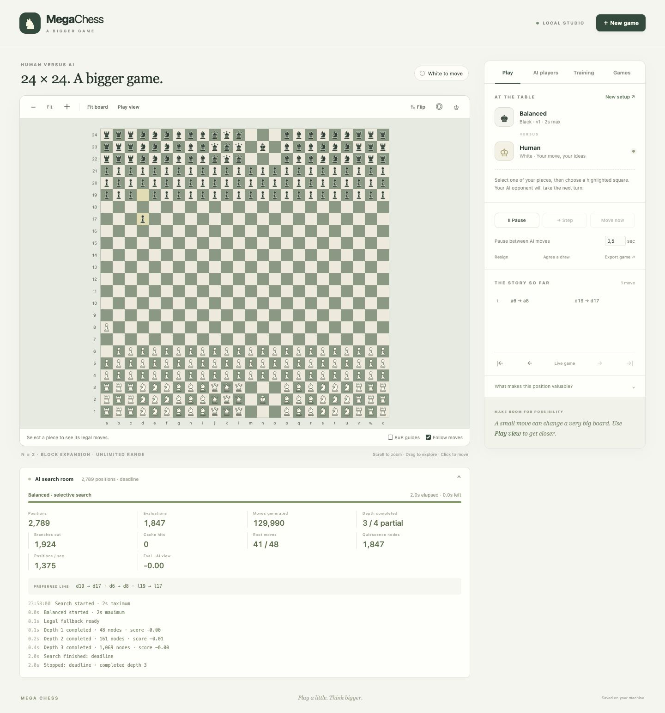

# Mega Chess

A larger chess world, with a Python rules engine, time-limited search, four independently learning AI personalities, and a single browser interface.



## Run locally

Requires Python 3.12 or newer.

```sh
python3 -m venv .venv
source .venv/bin/activate
python -m pip install -e '.[dev]'
python -m megachess
```

Open **http://127.0.0.1:8765**. Python serves both the page and its API. No API keys, external AI service, Node build, or account is needed.

```sh
python -m megachess --port 8765 --data-dir /path/to/local/megachess-data
python -m pytest
```

The default data location is `~/Library/Application Support/MegaChess` on macOS, `%LOCALAPPDATA%/MegaChess` on Windows, or `$XDG_DATA_HOME/megachess` (usually `~/.local/share/megachess`) on Linux. `MEGACHESS_DATA_DIR` overrides it. Keep the live database on local disk outside Dropbox or another synchronised folder. Use **Back up database** to make a consistent copy for archiving.

## Play

Choose Human or an AI separately for White and Black. Two Humans means taking turns on the same keyboard. AI versus AI supports pause, single step, and an independent viewing delay. New games preserve the previous board in Saved Games.

Use Fit for an overview, Play View for readable pieces, the wheel or pinch to zoom, and drag to pan. A small overview map helps navigate. Click a piece and then a legal destination. The board toolbar can locate either king or the last move. Arrow keys navigate squares, Enter selects/moves, and Escape cancels selection.

**Piece squares** above the board optionally colors occupied squares. It defaults to **None**; choose red/blue, blue/red, amber/violet, or teal/orange, with White's color listed first. The same colors appear in the overview map and starting-formation preview.

After choosing team colors in **Piece squares**, enable **Shade by piece** to give pawns, knights, bishops, rooks, queens, and kings distinct shades within each team’s color family. The two-row color key identifies each shade. It works on the board, minimap, and setup preview even at zero board opacity, and follows the actual piece type after promotion. The palette and checkbox are remembered in this browser. With both shade mode and **Highlight King** enabled, kings retain their team shade with a gold outline.

Open **Board background** above the board to adjust **Background tone** from black to white and **Board opacity** from faint to solid. These controls change the squares while keeping piece symbols, team colors, king highlights, and move trails vivid. Settings also apply to the minimap and setup preview, are remembered in this browser, and can be restored with **Reset**.

**Animate moves** is on by default. Pieces slide to their destination with a short hop, an origin marker, and a fading directional arrow, in both live play and adjacent replay steps. Animation adapts to the replay speed; large timeline jumps snap directly to the selected position. Reduced-motion preferences use the directional trail without sliding. Uncheck **Animate moves** to use static move highlights.

Turn on **Highlight King** beside the piece-square colors to mark both kings in gold. The markers follow the displayed position during live play and replay, and also appear in the minimap and setup preview.

Compact army summaries above the board show remaining pieces by symbol and count. The trays beside the board show what each player has captured, grouped by the actual victim's type; on phones they move beneath the board. The lower strip shows legal moves for the player to move, available capturing moves, move number, material edge, total captures, and board occupancy. All counts follow replay positions. En passant and captured promoted pieces are included correctly. Material uses the fixed conventional values listed below, independently of learned AI weights.

Frontend bookkeeping checks use Node's built-in test runner (development only): `node --test tests/*.test.mjs`.

Use the **Game timeline** slider below the board to inspect any recorded step, including the starting position. **Play** loops through the history at 0.1 seconds per move by default and turns into **Stop**, which freezes the displayed step. Adjust **Seconds / move** (0.05–10 seconds) to change the replay speed, including while playback is running. The loop includes new moves as they are recorded. Scrubbing or using the other replay controls stops playback; **Live** returns to the latest position. Replay only changes the view, so an AI match can keep playing while you watch its history. Captured-piece trays and position statistics follow the displayed step.

### Rules

- Odd N from 3 through 65 produces an **8N × 8N** board (up to **520 × 520 squares**); N=1 is a reference mode with castling disabled.
- **Block expansion:** every original square becomes N×N squares; one king remains at the middle of its king block or on the right central file. Each side has **15N² + 1** pieces.
- **Repeated rows:** the ordinary two ranks repeat across the board, retaining the middle copy's king. Each side has **15N + 1** pieces.
- Empty discarded king slots remain empty. Black mirrors White vertically.
- Rook, bishop, and queen movement is unlimited or capped at a selected number of squares (8, 16, etc.). All intervening pieces block sliding moves.
- Pawns move and capture normally, including a two-square first move from their individual original square, en passant, and promotion. Knights and kings are unscaled.
- Strict check, checkmate, and stalemate apply. Kings are never captured. Castling is disabled.
- Draws include threefold repetition and bare kings. The optional no-progress rule counts full moves per side without a pawn move or capture. It is disabled by default.

## Time-limited AI

Each side has an independent maximum thinking time, including **30 and 60 seconds**. The default is two seconds. This is an upper limit: an AI can return sooner when it finds mate or reaches a node/depth limit.

The custom engine uses iterative-deepening negamax, alpha-beta pruning, capture/promotion quiescence, move ordering, a bounded transposition table, and reversible moves with incremental board features.

**Selective** mode orders all legal candidates and searches the best-ranked subset (default 48 at the root and 16 at subsequent nodes). It never applies candidate-width limits to check evasions. **Full-width** mode removes these heuristic candidate limits, while retaining alpha-beta pruning. Selective results describe the selected tree, not an exhaustive proof across discarded moves.

The deadline includes process startup and candidate generation. A supervisor retains the legal fallback and completed-iteration results. It can terminate only the relevant isolated child at the deadline. **Move Now** uses the available best result early. Very short custom budgets may expire before a fallback is ready; the game then pauses rather than inventing a move.

Expand **AI Search** to see elapsed/remaining time, generated moves, searched nodes, evaluations, depth, root coverage, cutoffs, transposition hits, and the preferred line. The live log is bounded; final diagnostics are saved with each move. Cutoffs count branches actually cut off, not an invented count of all unvisited positions.

## Profiles and learning

Balanced, Aggressive, Defensive, and Explorer share the same search implementation. They differ in evaluation priorities, exploration, and learning rate. Clone or edit their weights and search settings in AI Players.

Material starts at pawn 1, knight 3.2, bishop 3.3, rook 5, queen 9. Positional features cover pawn advancement, activity, approach to the opposing king, and local king shelter/pressure. Features use board coordinates and an army-size normalization. Search scores are heuristic values, not calibrated win probabilities.

Weights are **frozen for an entire game**. After a genuine completed game, post-game TD(λ) (default λ=0.7, γ=1) compares successive predictions and the terminal outcome, applies a small bounded averaged update, and creates an immutable new version. Separate learned heads are maintained for each personality and exact ruleset. Restart-safe receipts prevent training on the same game twice. New games automatically choose the latest applicable learned head; existing games retain their original snapshot.

Learning is an experiment, not a guarantee of improvement. Keep frozen profiles and compare them using separate benchmark games. Interrupted and ply-limited games have no terminal training label. Human-entered draw adjudications against an AI are not learning labels.

## Batch experiments

Training can schedule hundreds of games. The default is 100 games, 5,000 nodes per move, and a 1,000-ply safety limit. Try the small pilot first to measure runtime. The largest boards can require substantial compute; no throughput or playing-strength claim is made.

Games are paired with colors reversed and identical seeded legal opening prefixes. Profiles are frozen for a cohort. Deterministic node budgets are used for comparisons; a wall-clock safety limit still applies. Turn learning off for benchmarks, which also disables exploration. Use a separate seed range for held-out benchmarks.

The queue and each completed move are durable. Pause/resume/cancel batches in the page. Restarting the server resumes running work. Batch learning is applied in scheduled order after the cohort completes. A cutoff is reported separately from a chess draw and excluded from outcome learning.

Interactive searches have their own capacity and take priority over new batch searches. Worker counts are bounded. Keep the server running for training to continue; closing only the browser does not stop the Python server.

## Saved data and exports

SQLite stores games, full replay snapshots, moves, seeds, immutable profiles, batches, outcomes, feature vectors, and search summaries. The full search tree is not stored. Full snapshots favor exact replay but can consume significant storage in long games on large boards.

- **Saved Games:** reopen and replay a match.
- **Game JSON:** complete replay and configuration.
- **Training JSONL:** recorded features, moves, outcomes, profiles, and search statistics for completed games.
- **Database backup:** consistent SQLite backup in the data directory's `backups` folder.

Database schema version: 1. Engine/rules version is stored with games and exports. Back up the database before upgrading an existing installation.

## Project structure

```text
megachess/
  engine.py       Board setup, legal moves and game outcomes
  search.py       Interruptible, instrumented game-tree search
  runtime.py      Search supervision and durable batch scheduling
  storage.py      SQLite, immutable profiles, replay and exports
  learning.py     Post-game TD learning
  server.py       HTTP API and single-page delivery
  web/            Canvas interface, styles and local piece artwork
tests/            Rules, search, persistence, learning and API checks
```

The API is under `/api/v1`; interactive documentation is at `/docs`. Python is authoritative. Clients submit an expected revision with moves; stale requests cannot overwrite another position.

This is a local, single-user application. It binds to loopback by default. Public server deployment and internet multiplayer require a separate hosting/access design; GitHub hosts the source, not the Python runtime.

